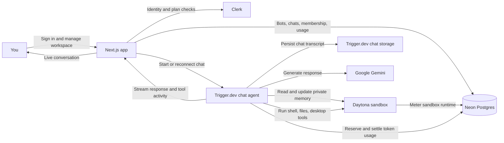
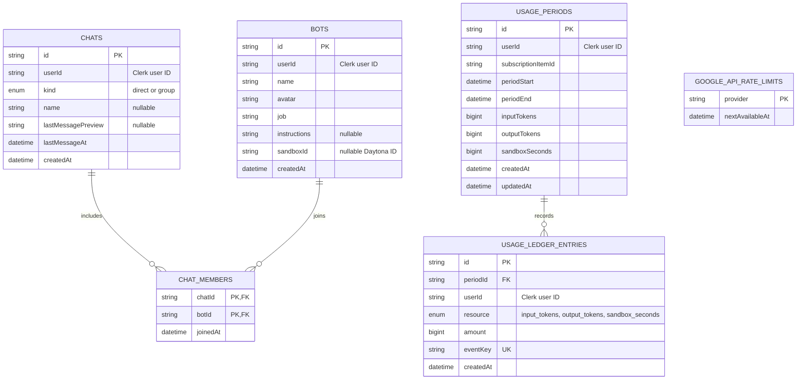
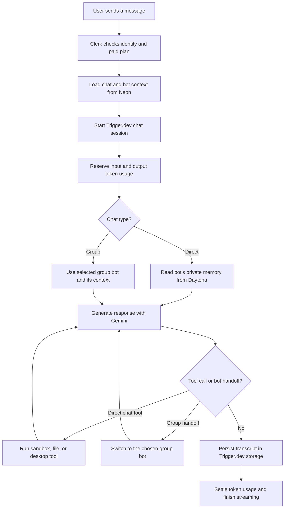

# AI Teammates

<div align="center">

### Your own AI team, built around the way you work.

Create specialists with their own roles, instructions, memory, and isolated desktop workspaces. Work with one teammate directly or bring several together in a group chat.

[Features](#-what-you-can-do) · [How it works](#-how-it-works) · [Get started](#-get-started) · [Configuration](#-environment-variables)


</div>

---

## ✨ What you can do

- **Build AI teammates** with a name, a job, custom instructions, and a generated avatar.
- **Chat one-on-one** and let each bot keep useful, private context in its own `MEMORY.md`.
- **Bring bots into group chats.** Teammates can hand a turn to another bot when its specialty is a better fit.
- **Give bots a computer.** Each bot gets an isolated Daytona sandbox with shell, file, and desktop tools.
- **Track metered usage** for AI tokens and sandbox runtime from the usage dashboard.
- **Manage plans and accounts** with Clerk Billing and Clerk authentication.

Bot creation, chats, and sandbox access require an active paid plan. The current plan slug is `pro`.

## 🧭 How it works



### A chat turn, step by step

1. Clerk verifies the signed-in user and checks their active plan.
2. The app loads the chat and the selected bot or group members from Neon.
3. Trigger.dev runs the chat agent and streams the turn back to the UI.
4. The agent uses Gemini for responses. In a direct chat, it can also use that bot’s Daytona tools and private memory. Group chats support bot handoffs and do not expose desktop tools.
5. Token and sandbox usage are recorded against the active subscription period.

### Database relationships

This entity relationship diagram follows the Drizzle schema in `db/schema.ts`. Clerk owns user identities; `userId` fields reference Clerk IDs and are not database foreign keys.



### Chat execution workflow



## 🧰 Built with

| Area | Technology |
| --- | --- |
| Web app | Next.js 16, React 19, TypeScript, Tailwind CSS 4 |
| UI | shadcn/ui, Base UI, AI Elements |
| Authentication and plans | Clerk |
| AI | Vercel AI SDK, Google Gemini |
| Durable chat agent | Trigger.dev |
| Database | Neon Postgres, Drizzle ORM |
| Bot workspaces | Daytona isolated sandboxes |
| Monitoring | Sentry |

## 🚀 Get started

### Requirements

- Node.js 24 or newer and npm
- A Neon Postgres database
- Clerk application with Billing enabled and a plan whose slug is `pro`
- Google AI API key
- Trigger.dev project connected to this repository
- Daytona API credentials (needed for bot and sandbox features)

### 1. Install dependencies

```bash
npm install
```

### 2. Configure environment variables

Create `.env.local` in the project root and add the values described in [Environment variables](#-environment-variables). Keep secrets private; `.env*` files are ignored by Git.

### 3. Create or update the database schema

```bash
npm run db:push
```

Drizzle uses `DATABASE_URL_UNPOOLED` when it is set, otherwise it uses `DATABASE_URL`.

### 4. Start the app and the Trigger.dev worker

Run each command in a separate terminal:

```bash
npm run dev
```

```bash
npx trigger.dev dev
```

Open [http://localhost:3000](http://localhost:3000), sign in, and use the workspace. Trigger.dev must be running locally to process chat sessions.

## 🔐 Environment variables

| Variable | Required | Purpose |
| --- | :---: | --- |
| `NEXT_PUBLIC_CLERK_PUBLISHABLE_KEY` | Yes | Clerk client configuration. |
| `CLERK_SECRET_KEY` | Yes | Server-side Clerk auth and billing access. |
| `DATABASE_URL` | Yes | Pooled Postgres connection used by the app. |
| `DATABASE_URL_UNPOOLED` | Recommended | Direct connection for Drizzle schema pushes. Falls back to `DATABASE_URL`. |
| `GOOGLE_GENERATIVE_AI_API_KEY` | Yes | Gemini model access for AI responses. |
| `TRIGGER_SECRET_KEY` | Yes | Connects the local Trigger.dev worker to the project. |
| `DAYTONA_API_KEY` | Yes for bot features | Creates and controls isolated bot sandboxes. |
| `DAYTONA_API_URL` | Optional | Custom Daytona API endpoint. `DAYTONA_SERVER_URL` is also accepted by the client. |
| `NEXT_PUBLIC_CLERK_SIGN_IN_URL` | Optional | Sign-in route; set to `/sign-in` when configuring Clerk paths. |
| `NEXT_PUBLIC_CLERK_SIGN_UP_URL` | Optional | Sign-up route; set to `/sign-up` when configuring Clerk paths. |
| `NEXT_PUBLIC_CLERK_SIGN_IN_FALLBACK_REDIRECT_URL` | Optional | Fallback destination after sign-in. |
| `NEXT_PUBLIC_CLERK_SIGN_UP_FALLBACK_REDIRECT_URL` | Optional | Fallback destination after sign-up. |
| `NEXT_PUBLIC_SENTRY_DSN` | Optional | Sentry error reporting and browser monitoring. |
| `SENTRY_DSN` | Optional | Server/worker Sentry DSN; falls back to the public DSN. |
| `SENTRY_ENVIRONMENT` | Optional | Overrides the Sentry environment name. |
| `SENTRY_AUTH_TOKEN` | Optional | Build-time token for uploading source maps to Sentry. |

Keep all secret keys and tokens out of client-side code and source control.

## 🗂️ Project structure

```text
app/
  (dashboard)/       Workspace, chats, pricing, and usage pages
  actions/           Server actions for chat sessions and sandbox previews
  sign-in/           Clerk sign-in page
  sign-up/           Clerk sign-up page
action/              Bot and group-chat actions
components/           Workspace UI, chat UI, and shared components
db/                   Drizzle connection, schema, and validators
lib/                  Billing, usage, Gemini rate limiting, and Daytona helpers
queries/              Bot and chat data access
trigger/              Durable AI chat agent
drizzle.config.ts      Drizzle Kit configuration
trigger.config.ts      Trigger.dev worker configuration
```

## 🧑‍💻 Useful commands

| Command | Description |
| --- | --- |
| `npm run dev` | Start the Next.js development server. |
| `npx trigger.dev dev` | Start the local Trigger.dev development worker. |
| `npm run build` | Build the app for production. |
| `npm run start` | Start the production server after a build. |
| `npm run lint` | Run ESLint. |
| `npm run typecheck` | Check TypeScript types. |
| `npm run db:push` | Apply the Drizzle schema to the configured database. |
| `npm run db:studio` | Open Drizzle Studio. |

## 📈 Monitoring and usage

Sentry is wired for browser, Node.js, Edge, and Trigger.dev runtime errors. When configured, tracing and Session Replay are sampled at 100% in development and 10% in production; sessions with errors are always recorded. Replay masks text and inputs and blocks media. Structured application logs avoid recording prompts, file contents, credentials, and raw exception messages.

Usage is metered across input tokens, output tokens, and Daytona sandbox runtime. The usage page shows consumption for the active subscription period. Plan limits and the maximum bot count are defined in `lib/usage.ts`.
